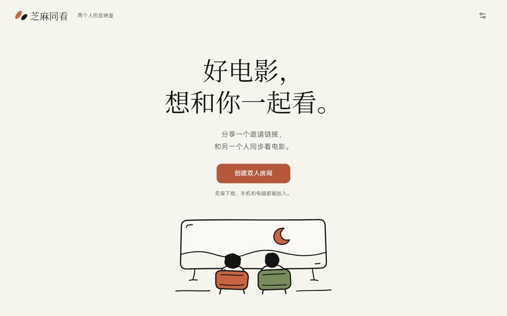
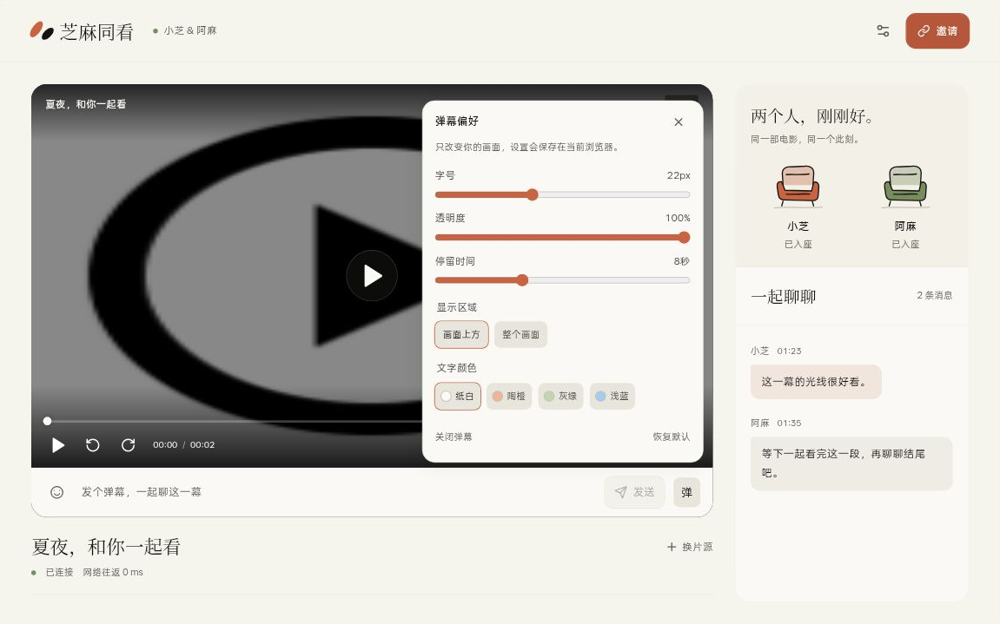
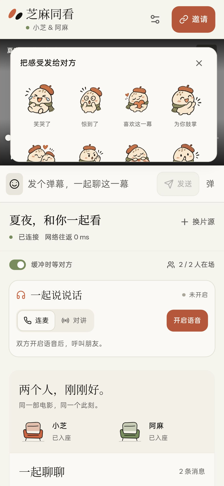

# 芝麻同看 · Zhima Watch

**好电影，想和你一起看。**

一个为两个人准备的网页放映室。创建房间，把邀请链接发给对方，即可同步看视频、发弹幕、聊语音。手机和电脑都能使用，无需注册账号。

[在线体验](https://mh.080712.xyz) · [界面演示](#界面演示) · [部署自己的站点](#部署自己的站点) · [本地开发](#本地开发)

[](../../actions/workflows/deploy.yml)

> **部署前请先 Fork。** 在自己的 Fork 中配置 Cloudflare 凭据，再点击部署按钮。详细步骤见下方说明。

## 界面演示

### 首页

浅色纸感界面，从创建一间放映室开始。



### 桌面房间

在同一个房间里选片、同步播放、发送聊天与图像表情，也可以开启语音。



### 手机房间

适配竖屏观看与聊天，也支持浏览器允许的全屏播放和画中画。



截图使用演示房间和示例消息，展示界面布局与功能入口；不代表实际双设备播放或语音连通性测试结果。

## 可以做什么

| 功能 | 说明 |
| --- | --- |
| 双人同步观影 | 支持 MP4 直链和 HLS（M3U8），同步播放、暂停、跳转和倍速；可开启「缓冲时等对方」。 |
| 聊天与弹幕 | 支持文字和 12 个图像表情。弹幕字号、透明度、停留时间、区域与颜色可调，偏好只保存在当前浏览器。 |
| 语音连麦 | 双方启用语音后，一方呼叫、另一方接听，持续通话。 |
| 按住对讲 | 双方切到对讲模式并开启收听，按住说话、松开停止发送；接收消息不会自动打开麦克风。 |
| 多端观看 | 手机与电脑布局、全屏控件，以及浏览器支持时的视频画中画。 |
| 私人房间 | 无账号系统，邀请链接包含入房凭据；最多两位成员，房间创建后 24 小时过期。 |

双方分别从原片源加载视频，服务端只传递房间状态、播放指令和聊天内容，不代理或托管视频文件。项目不提供影视资源库，需要自行准备双方都有权访问的片源。

## 怎么一起看

1. 打开站点，创建房间，设置自己的昵称。
2. 复制邀请链接发给对方，等待对方进入。
3. 在选片入口填入可播放的 HTTPS 视频地址，支持 MP4 或 M3U8。
4. 开始播放。任意一方的播放、暂停、跳转和倍速操作会同步给另一方。
5. 按需开启弹幕、语音或「缓冲时等对方」。建议戴耳机使用语音。

网页浏览模式只能嵌入允许被嵌入的页面，不能同步第三方网页内部播放器的播放进度；一起看视频时优先使用视频直链。

## 部署自己的站点

### 通过 GitHub Actions 部署

**先 Fork，再在自己的仓库中运行。**

[](../../actions/workflows/deploy.yml)

1. 点击仓库右上角 **Fork**，进入自己账号下的仓库。
2. 准备自己的 Cloudflare 账号，完成 Workers 设置并启用 `workers.dev` 子域名。
3. 在 Fork 的 **Settings → Secrets and variables → Actions → New repository secret** 中添加以下两项：

   | Secret 名称 | 填写内容 |
   | --- | --- |
   | `CLOUDFLARE_ACCOUNT_ID` | 你的 Cloudflare 账户 ID。 |
   | `CLOUDFLARE_API_TOKEN` | 你的 Cloudflare API 令牌。可使用「Edit Cloudflare Workers」模板，仅授权需要部署的账户；不要填写 Global API Key。 |

4. 打开 Fork 的 **Actions** 页面，首次使用时启用工作流。
5. 点击上面的按钮，或在 Actions 中选择 **Deploy to Cloudflare**，点击 **Run workflow → Run workflow**。
6. 等待检查、构建与部署完成，在 **Deploy Worker and assets** 日志中查看 `workers.dev` 访问地址。

按钮会打开**当前仓库**的部署工作流，Fork 后自动指向自己的仓库。原仓库不提供访客部署；在非 Fork 仓库运行时，工作流会停止并提示「请先 Fork」。首次配置完成后，再次运行同一工作流即可更新站点；需要获取上游更新时，先在 Fork 中执行 **Sync fork**。

部署会创建 Worker、静态资源和 SQLite-backed Durable Object。自定义域名可在 Cloudflare 中另行绑定。凭据只保存在自己仓库的 Actions Secrets 中，不要提交到代码、截图或 Issue。

### 使用命令行部署

需要 Node.js 22+、npm，以及自己的 Cloudflare Workers 账号。

```sh
npm ci
npx wrangler login
npm run deploy
```

公开的 [wrangler.jsonc](wrangler.jsonc) 已包含静态资源、Durable Object 绑定及迁移配置。部署前检查 Worker 名称；如果已有房间数据，保持绑定、类名和迁移历史一致。

如需维护自定义域名等本地配置，可复制公开配置为 `wrangler.local.jsonc`，编辑后使用：

```sh
npm run build
npx wrangler deploy --config wrangler.local.jsonc
```

`wrangler.local.jsonc` 已被 Git 忽略；已有该文件时先检查内容再编辑。

## 本地开发

使用 **Node.js 22+** 和 npm。先安装依赖：

```sh
npm ci
```

在第一个终端构建静态资源并启动 Worker：

```sh
npm run build
npm run dev:worker
```

在第二个终端启动前端：

```sh
npm run dev
```

打开 Vite 输出的地址。默认开发代理将 `/api` 和 WebSocket 转发到 `http://127.0.0.1:8787`，两个进程需要同时运行。

环境配置示例见 [.env.example](.env.example) 和 [.dev.vars.example](.dev.vars.example)。需要时分别复制为 `.env.local` 和 `.dev.vars`，编辑后重启开发进程。已有 `.env.local` 时检查 `DEV_API_ORIGIN`，连接本地 Worker 应使用 `http://127.0.0.1:8787`。

本地 Worker 依赖 workerd；部分 PRoot 等容器环境无法运行该运行时。此时需要在受支持的环境运行后端，或将开发代理指向自己的已部署后端。

### 环境变量

| 变量 | 使用位置 | 说明 |
| --- | --- | --- |
| `DEV_API_ORIGIN` | Vite 开发服务器 | 后端地址，默认 `http://127.0.0.1:8787`。通过 `.env` / `.env.local` 或命令行设置，不注入前端产物。 |
| `VITE_API_BASE` | 前端构建 | 默认留空，使用页面同源 API。分开部署时填写后端完整 Origin；此值公开，不可放入密钥。 |
| `ALLOWED_ORIGIN` | Worker | 默认只接受同源来源。可额外允许一个前端精确 Origin，包含协议、主机和可选端口，不含路径或末尾斜杠。 |

同源部署和默认开发代理通常不需要设置 `ALLOWED_ORIGIN`。前后端分开部署时，同时设置 `VITE_API_BASE` 与 Worker 的 `ALLOWED_ORIGIN`。开发代理保留 WebSocket 转发及 Origin 改写。

### 检查命令

```sh
npm test
npm run build
npm run check:worker
```

[检查工作流](.github/workflows/check.yml) 在推送和 Pull Request 时运行以上检查；[部署工作流](.github/workflows/deploy.yml) 仅手动触发。自动检查不能代替跨设备播放、真实麦克风、画中画和移动设备的人工验收。

## 技术结构

- **前端：** React 19、TypeScript、Vite、hls.js、Lucide。
- **房间后端：** Cloudflare Workers 与 SQLite-backed Durable Objects，每个房间独立维护状态，通过 WebSocket 广播。
- **语音：** PeerJS 与浏览器 WebRTC，公共 PeerServer 负责连接协商，音频通过 P2P 传输。

| 路径 | 内容 |
| --- | --- |
| [src/](src/) | 页面、播放器、聊天、同步与语音逻辑。 |
| [worker/](worker/) | 房间 API、WebSocket、状态存储与输入校验。 |
| [tests/](tests/) | 自动测试、线上回归脚本与本地验证页面。 |
| [.github/workflows/](.github/workflows/) | 持续检查与手动部署工作流。 |
| [docs/screenshots/](docs/screenshots/) | README 演示截图。 |

## 使用限制与隐私

### 片源与浏览器

- 视频需使用 HTTPS；编码、浏览器能力、跨域策略和链接有效期都会影响播放。HLS 的播放列表及分片需要允许相应跨域请求。
- 同步效果受网络、缓冲、解码和系统调度影响。页面延迟及偏差是估算值，不保证跨设备毫秒级一致。
- 自动播放、声音、全屏、画中画和后台运行可能受到浏览器的手势与权限限制。
- 系统画中画通常只显示视频，网页聊天、弹幕和控制层未必能进入画中画；部分系统全屏也有同样限制。

### 语音

语音默认使用公共 PeerServer `0.peerjs.com` 协商连接，ICE 明确配置为 **STUN-only，不提供 TURN 中继**。部分 NAT、防火墙和运营商网络下可能无法连通，公共信令服务也可能不可用。

麦克风需要 HTTPS 或浏览器认可的 localhost 安全上下文，并由用户主动授权。对讲松手会停止当次麦克风采集；连麦在窗口失焦或切到后台时自动静音，返回后需手动取消静音。关闭语音、离开页面或房间连接失效时会释放麦克风。

P2P 连接可能让对方获知你的 IP 地址；公共信令与 STUN 服务会接触连接元数据。项目没有录音功能，但无账号并不意味着匿名。

### 房间数据

邀请链接包含入房凭据，请只分享给一起观看的人。房间状态及最近聊天记录存储在 Durable Object 中，房间按创建后 24 小时的有效期过期清理。片源链接会发送给对方，双方浏览器也会直接访问片源服务；请使用有权观看、分享且双方均能访问的内容。

## 许可与素材

代码使用 [MIT License](LICENSE)，第三方依赖许可见 [THIRD_PARTY_NOTICES.md](THIRD_PARTY_NOTICES.md)。

- 中文衬线字体子集来自 Noto Serif CJK SC，使用 SIL Open Font License 1.1，见 [字体许可](src/assets/fonts-OFL.txt)。
- SVG 插画为项目原创，12 个图像表情由 AI 生图生成。AI 生成素材的可版权性与使用条件取决于适用法律，不保证排他权或绝对不存在第三方权利问题。

本地环境文件、Wrangler 本地配置、构建产物和工具数据均不纳入版本控制。
